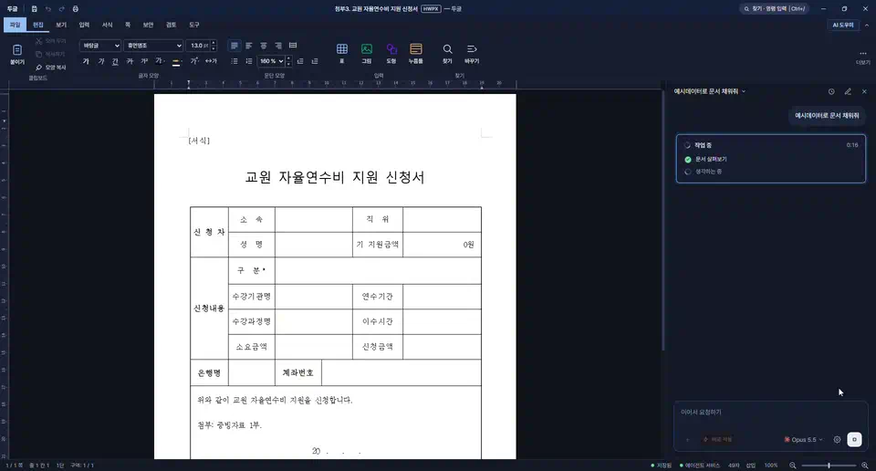

# 두글 (doogle)

두글은 HWP/HWPX 문서를 열고 편집하는 데스크탑 편집기다. 옆 창의 AI 에이전트(Claude 또는
ChatGPT)에게 말로 부탁하면 문서를 읽고, 고칠 내용을 제안하고, 승인한 변경만 문서에 반영한다.



빈 신청서를 열고 "예시데이터로 문서 채워줘" 라고 부탁한 장면이다. 에이전트가 문서를 살펴본 뒤 칸 16곳을 채운다.

## 참고 파일 붙이기

입력 상자의 `+` 단추를 누르거나 파일을 사이드바에 끌어다 놓으면(그림은 붙여 넣기도 된다) 참고 파일로 붙는다.
한 번에 10개까지 붙일 수 있고, 붙인 파일은 그 대화에 남아 다음 요청에서도 에이전트가 읽는다.
"붙인 엑셀의 예산 시트를 표로 넣어줘", "붙인 규정을 참고해서 신청서를 채워줘" 처럼 부탁하면 된다.

| 형식 | 읽는 내용 |
| --- | --- |
| 한글 문서 (hwp · hwpx) | 본문 문단과 표 |
| PDF | 쪽마다의 글. 글이 없는 쪽(스캔본)은 그림으로 |
| Word · Excel · PowerPoint (docx · xlsx · pptx) | 본문·표, 시트의 값, 슬라이드의 글 |
| 그림 (png · jpg · webp · gif · bmp) | 그림 그대로 |
| 글 (txt · md · csv · json …) | 글 그대로 (EUC-KR 도 읽는다) |

참고 파일은 읽기 전용이다. 에이전트가 고치는 것은 편집기에 열린 문서뿐이다.

## 개발 실행

필요한 것: Node 22 이상, Rust stable(`wasm32-unknown-unknown` 타깃), wasm-pack, Tauri 2 빌드 환경.

```sh
# 1. 엔진을 WASM 으로 빌드한다 (저장소 루트에서, 처음 한 번과 src/ 를 고친 뒤)
scripts/wasm-pack-locked.sh --target web --out-dir pkg      # Windows: scripts\wasm-pack-locked.cmd ...

# 2. 의존성 설치
cd rhwp-studio; npm install; cd ..
cd doogle-agent; npm install; cd ..

# 3. 데스크탑 앱 실행 (rhwp-studio 개발 서버를 함께 띄운다)
cd doogle-desk; npm install; npm run tauri dev
```

AI 사이드바는 사용자 PATH 의 Node 22+ 로 `doogle-agent` 허브를 띄운다. Node 가 없으면 편집기만 동작한다.

## 구성

| 경로 | 내용 |
| --- | --- |
| `doogle-agent/` | AI 에이전트 허브(Node). 모델 제공자 연결, 문서 도구, MCP 브리지 |
| `doogle-desk/` | Tauri 2 데스크탑 셸. 창, 파일 열기·저장, 허브 실행, 자동 업데이트 |
| `rhwp-studio/` | 편집기 화면(Vite + TypeScript). 두글 전용 UI 는 `src/doogle/`, 진입 페이지는 `doogle.html` |
| `src/` | Rust 문서 엔진(HWP/HWPX 파서·조판·렌더러·직렬화). WASM 으로 빌드해 `pkg/` 에 둔다 |
| `docs/doogle/` | 설계·도구·릴리스 문서 |

릴리스와 자동 업데이트, upstream 동기화는 [docs/doogle/RELEASE.md](docs/doogle/RELEASE.md) 를 본다.

## 출처와 라이선스

- 문서 엔진과 편집기 화면은 [edwardkim/rhwp](https://github.com/edwardkim/rhwp)(MIT)를 바탕으로 한다.
  두글에 필요 없는 upstream 파일은 이 저장소에서 뺐다(목록: `.doogle-prune`).
- 에이전트 도구 설계는 [banatic/rhwp-x](https://github.com/banatic/rhwp-x)(MIT)에서 가져왔다.
- 라이선스는 [LICENSE](LICENSE)(MIT), 서드파티 고지는 [THIRD_PARTY_LICENSES.md](THIRD_PARTY_LICENSES.md),
  [THIRD_PARTY.md](THIRD_PARTY.md), `licenses/`, 글꼴 고지는 [docs/doogle/FONTS.md](docs/doogle/FONTS.md) 에 있다.

본 제품은 한글과컴퓨터의 한글 문서 파일(.hwp) 공개 문서를 참고하여 개발하였습니다.
