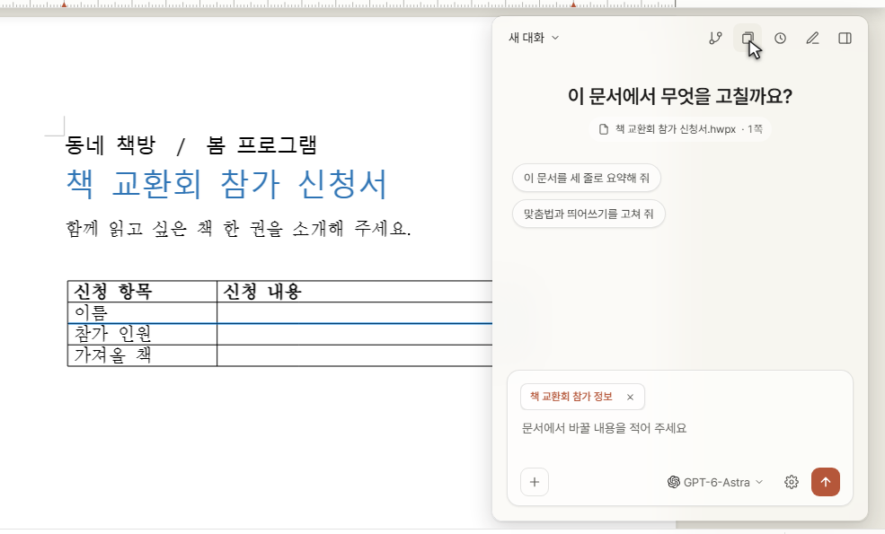
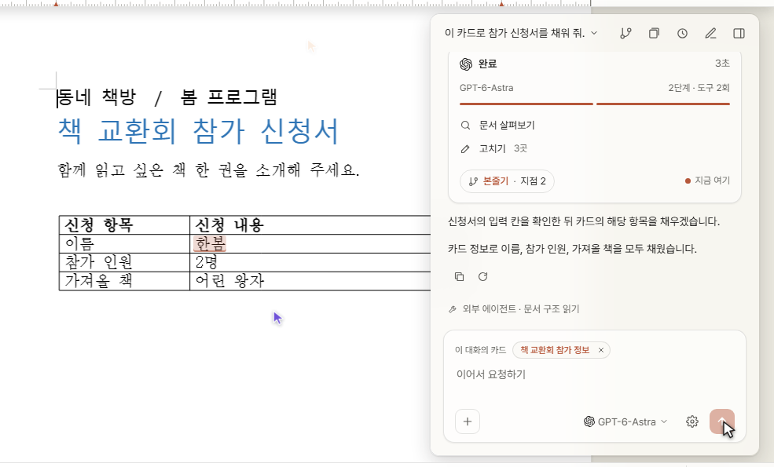
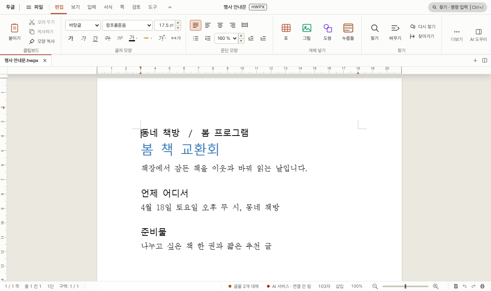

# 두글 (doogle)

두글은 HWP·HWPX 데스크톱 편집기입니다.

[설치 파일 다운로드](https://github.com/banatic/doogle/releases/latest)

## 에이전트로 HWP 수정하기



AI 도우미를 쓰려면 Node.js 22 이상을 설치하고 두글 설정에서 ChatGPT 또는 Claude를 연결하세요. 

API 키로도 연결할 수 있습니다.


## Branch 시스템



## Split 창



## 개발 실행

Node.js 22 이상, Rust와 `wasm32-unknown-unknown` 타깃, wasm-pack, Tauri 2 빌드 환경이 필요합니다. 저장소 루트에서 실행하세요.

```sh
# 문서 엔진 빌드 (Windows에서는 아래 .cmd 명령 사용)
./scripts/wasm-pack-locked.sh --target web --out-dir pkg
# .\scripts\wasm-pack-locked.cmd --target web --out-dir pkg

npm --prefix rhwp-studio ci
npm --prefix doogle-agent ci
npm --prefix doogle-desk ci
npm --prefix doogle-desk run tauri dev
```

빌드와 배포 절차는 [릴리스 가이드](docs/doogle/RELEASE.md)에 있습니다.

## 출처와 라이선스

문서 엔진과 편집기는 [rhwp](https://github.com/edwardkim/rhwp)를 기반으로 하고 있습니다. MIT 라이선스입니다.

[두글 라이선스 (MIT)](LICENSE) · [서드파티 구성 요소](THIRD_PARTY.md) · [서드파티 라이선스](THIRD_PARTY_LICENSES.md) · [글꼴 고지](docs/doogle/FONTS.md)

본 제품은 한글과컴퓨터의 한글 문서 파일(.hwp) 공개 문서를 참고하여 개발하였습니다.
